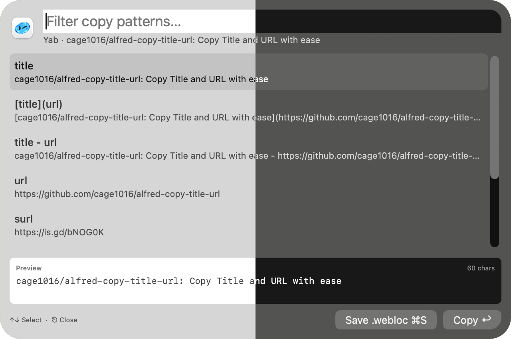

# Alfred Copy Title URL
> Copy the title and URL from the frontmost browser — or save it as a `.webloc` — with ease.

[](https://github.com/cage1016/alfred-copy-title-url/actions/workflows/ci.yml)
[](https://github.com/cage1016/alfred-copy-title-url/actions/workflows/release.yml)
[](https://lbesson.mit-license.org/)


## Features
- **Alfred 6 Native UI**: Embedded picker with instant search filtering and live formatted preview.
- **Zero External Dependencies**: Built with Python 3 standard library — no Alfred Automation Tasks required.
- **Frontmost Browser Detection**: Automatically finds the topmost running supported browser by macOS window Z-order.
- **Background URL Shortening**: Pre-shortens URLs via `is.gd` or `v.gd` when `surl` patterns are configured.
- **Save `.webloc` to Finder / QSpace**: Save the active tab URL directly to the frontmost Finder, QSpace, or QSpace Pro window via [`fmctl`](https://github.com/cage1016/fmctl).

## Requirements
- [Alfred 6](https://www.alfredapp.com/) (Alfred UI)
- Optional: [fmctl](https://github.com/cage1016/fmctl) for saving `.webloc` directly into the frontmost Finder / QSpace / QSpace Pro window (falls back to Finder AppleScript or `~/Desktop` if not installed)

## Installation
Download the latest `CopyTitleURL-*.alfredworkflow` from [Releases](https://github.com/cage1016/alfred-copy-title-url/releases) and double-click to import into **Alfred 6**.

## Usage



### 1. Copy Title & URL Picker (`ctu` or Hotkey)
Trigger via the configured **Hotkey** (`⌃⌥⌘U` by default) or **Keyword** (`ctu`, optionally followed by a filter query):

| Action | Shortcut / Trigger |
|---|---|
| Filter patterns | Type in search box |
| Navigate list | `↑` / `↓` |
| Copy selected pattern | `↩`, double-click, or **Copy ↩** |
| Save URL as `.webloc` | `⌘S` or **Save .webloc ⌘S** |
| Close picker | `⎋` |

### 2. Direct Save URL as `.webloc` (`stu`)
Type `stu` in Alfred to immediately save the frontmost browser's active URL as a `.webloc` file into the frontmost Finder or QSpace window without opening the picker:
- `stu` — saves using the page title as filename
- `stu my-note` — saves as `my-note.webloc`

## Configuration
Open **Configure Workflow…** in Alfred Preferences to customize:
- **Keyword** (default: `ctu`): Keyword to open the Copy Title URL picker.
- **Save URL Keyword** (default: `stu`): Keyword to directly save the active URL as `.webloc`.
- **URL Shortener** (default: `is.gd`): Service used for the `surl` keyword (`is.gd` or `v.gd`).
- **Patterns**: One pattern per line using `title`, `url`, and `surl` (lines starting with `#` are ignored).

Default patterns:
```text
title
[title](url)
title - url
url
surl
title - surl
[title](surl)
=HYPERLINK("url", "title")
```

## Supported Browsers
Yab, Safari, Safari Technology Preview, Orion, Arc, Dia, Google Chrome (incl. Canary / Beta), Chromium, Brave Browser, Microsoft Edge, Vivaldi, Opera (incl. Opera GX).

## Development

```sh
make link    # Link .workflow into Alfred
make lint    # Validate info.plist and Alfred UI bundle
make test    # Run Python unit tests
make reload  # Reload workflow in Alfred 6
```

Releases are tag-driven via GitHub Actions: push a tag (e.g. `git tag v0.2.0 && git push origin v0.2.0`) to automatically inject the version into `info.plist`, run tests, package `CopyTitleURL-<version>.alfredworkflow`, and publish the GitHub Release.

## License
This project is licensed under the MIT License. See [LICENSE](LICENSE) for details.
